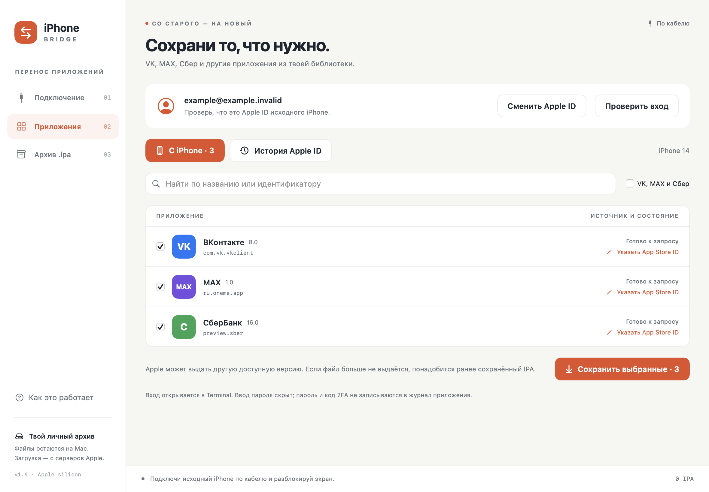

# iPhone Bridge

Нативная утилита для macOS: прочитать приложения на iPhone по USB, скачать доступные Apple ID установочные файлы, сохранить их в локальный архив и установить на другой iPhone.

Подходит в том числе для приложений, удалённых из App Store, **если Apple всё ещё разрешает скачать их этому аккаунту**. Наличие приложения на старом iPhone само по себе не гарантирует загрузку.



## Что умеет

- Показывает подключённые по USB iPhone и список установленных приложений.
- Входит в Apple ID через Terminal с поддержкой 2FA.
- Читает историю покупок и принимает числовой App Store ID или ссылку на приложение.
- Скачивает доступные IPA с серверов Apple, импортирует и экспортирует собственные IPA.
- Сохраняет SHA-256, сведения о приложении, исходном телефоне и Apple ID владельца архива.
- Устанавливает выбранные IPA на явно выбранный iPhone после подтверждения.
- Позволяет начать новый перенос или сменить аккаунт, сохранив архив.

Утилита не извлекает готовый IPA из установленного приложения, не переносит его данные и сессии, не покупает приложения и не выдаёт новые лицензии. Совместимость пакета и право запуска проверяет iOS. Уже установленные приложения пропускаются.

## Требования

- Mac с Apple silicon и macOS 26 или новее.
- Кабель с передачей данных, разблокированный iPhone и разрешённое доверие к Mac.
- Apple ID, которому доступна загрузка нужных приложений, и интернет для входа и скачивания.
- Актуальная системная поддержка iPhone в macOS.

Intel Mac и другие версии macOS в текущей сборке не поддерживаются. При обычном запуске собранного приложения Xcode, Homebrew, Go и Python не нужны. Подпись локальная, ad-hoc; notarization Apple нет.

## Сборка из исходников

Понадобятся Command Line Tools for Xcode, Go 1.27 или новее, Python 3.9 или новее и системный curl. Текущая версия — **1.6**.

```sh
# Выполнять из корня репозитория
bash Scripts/build-ipatool.sh
bash Scripts/build.sh
open "dist/iPhone Bridge.app"
```

Сначала собирается закреплённая версия ipatool с локальным патчем, затем приложение. Скрипт проверяет SHA-256 исходного архива и создаёт файл происхождения сборки. Бинарные файлы, готовое приложение и пакеты IPA в Git не включены.

## Как пользоваться

1. Подключи исходный iPhone, разблокируй его, подтверди доверие. В разделе «Подключение» обнови устройства, выбери телефон и прочитай приложения.
2. В разделе «Приложения» нажми «Войти». Подготовка соединения выполняется до запроса пароля. Заверши вход в Terminal и нажми «Проверить вход».
3. Выбери приложения. При отсутствии App Store ID используй историю покупок или укажи ID вручную. Нажми «Сохранить выбранные».
4. Подключи телефон-получатель. В «Архив .ipa» отметь файлы, выбери получателя и подтверди установку. Телефоны можно подключать по очереди одним кабелем.
5. Открой приложения на новом iPhone и войди в них заново.

Для другого исходного телефона есть «Новый перенос». Если приложения принадлежат другому аккаунту, используй «Сменить Apple ID». Архив сохраняется в обоих случаях.

Подробности и решения частых ошибок — в [инструкции](Documentation/Инструкция.md).

## Данные и ограничения

Библиотека хранится локально в `~/Library/Application Support/iPhone Bridge/`. Она содержит персональные сведения: Apple ID владельца, идентификатор и имя исходного телефона, список приложений и IPA. Не публикуй эту папку, содержимое окон авторизации или реальные логи.

Пароль вводится скрыто в Terminal; приложение не передаёт его в аргументах процесса. Авторизацию и хранение её состояния выполняет ipatool. У iPhone Bridge нет собственного сервера или телеметрии. Для работы программа обращается к сервисам Apple; подготовка компонентов может обращаться к указанным в исходниках внешним ресурсам.

Если Apple перестала выдавать конкретный IPA и своей сохранённой копии нет, утилита не восстановит его. Скачанная версия может отличаться от установленной на старом телефоне. Даже после успешной установки работа приложения зависит от iOS, Apple ID, подписи и серверов разработчика.

Используется непубличный системный API MobileDevice.framework. Обновления macOS, iOS и сервисов Apple могут повлиять на работу. Реальный вход и скачивание проверены; успешная загрузка одного приложения не гарантирует доступность остальных. Полную установку и запуск каждой версии нужно проверять на целевом устройстве.

## Документация

- [Инструкция и диагностика](Documentation/Инструкция.md).
- [Архитектура и защитные условия](Documentation/Архитектура.md).
- [Хранение данных и подготовка к публикации](Documentation/Конфиденциальность.md).
- [Разработка, тесты и сборка](Documentation/Разработка.md).
- [История изменений](CHANGELOG.md).
- [Сторонние компоненты](THIRD_PARTY_NOTICES.md).

Тесты запускаются командой `bash Scripts/test.sh` и используют синтетические IPA без подключения к Apple ID или iPhone.

## ipatool

Включён исходный архив [majd/ipatool](https://github.com/majd/ipatool), закреплённый на коммите `001d889896fcb118546443c5dfe0997d11b74f56`, и локальный патч. Текущий модуль определяется как `2.7.0+001d889.bridge6`.

Патч добавляет ограниченную по времени подготовку, повторное использование проверенных компонентов, обработку вставки 2FA и системный HTTPS-транспорт для строго ограниченных служебных адресов Apple. Подробнее — в [Vendor/ipatool/README.md](Vendor/ipatool/README.md). Лицензия ipatool — [MIT](Vendor/ipatool/LICENSE); она распространяется на этот сторонний компонент.
